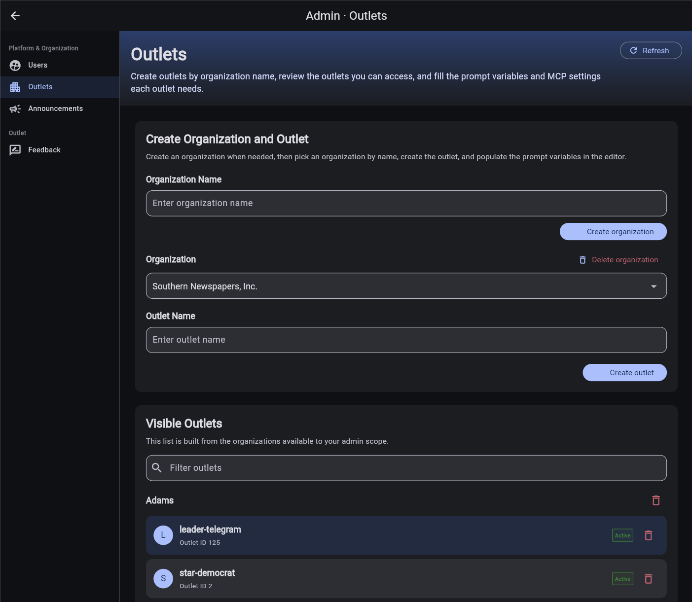
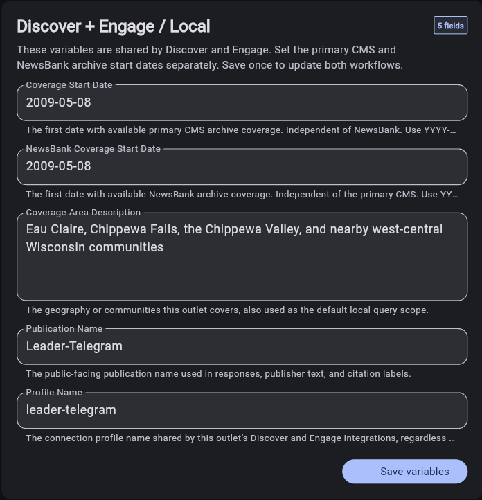
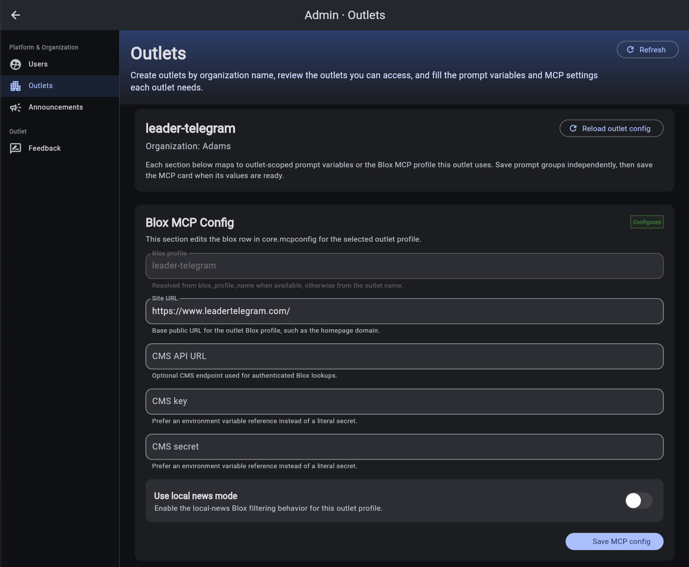
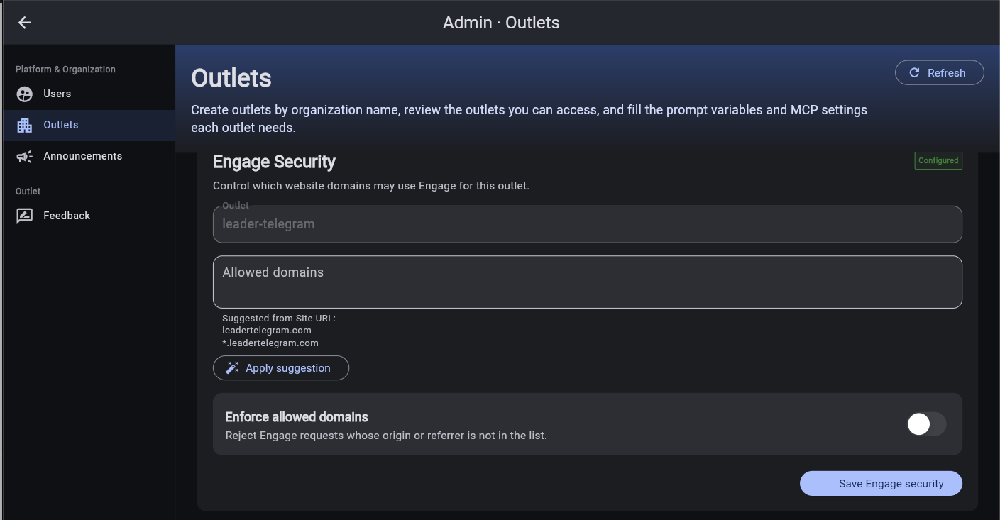

# Manage organizations and outlets

Use **Admin > Outlets** to maintain the organization hierarchy and the configuration Discover and Engage use for each outlet.

The page requires outlet-management access. Editing prompt variables, content permissions, CMS connection settings, or Engage security also requires assistant-configuration access. If you can open the page but the settings are read-only, ask a platform administrator to review that permission.

## Create or select an outlet



1. To add an organization, enter **Organization Name** and select **Create organization**.
2. Select an organization from the **Organization** list.
3. To add an outlet, enter **Outlet Name** and select **Create outlet**.
4. Under **Visible Outlets**, filter the list if needed and select the outlet to configure.

New organizations and outlets are selected automatically after creation. **Refresh** reloads the organization and outlet lists.

### Delete records carefully

- An organization can be deleted only when it has no outlets and no organization role assignments.
- An outlet can be deleted only when no users, role assignments, or projects reference it.

Both actions require confirmation. Resolve dependencies instead of deleting active records merely to rename or reorganize them.

## Configure an outlet

After you select an outlet, its prompt-variable groups, content permissions, CMS connection configuration, and Engage security configuration load together. The outlet variables appear first, followed by content permissions, connection settings, and Engage security. **Reload outlet config** discards unsaved field changes and reloads the saved values.

For a new outlet, use this order:

1. Complete and save the shared **Discover + Engage / Local** variables and any other required prompt-variable groups.
2. Configure **Content Permissions - Discover** if the outlet needs content-generation restrictions.
3. Verify the resolved outlet profile and save the CMS connection configuration.
4. Add allowed Engage domains, then enable enforcement when the list is ready.

## Complete prompt variables

Outlet variables supply publication identity, archive coverage, and the connection profile. This section is provider-neutral: use the same variable names whether the selected archive provider is BLOX, NewsBank, or another supported integration.

**Discover + Engage / Local** is one shared editor for both workflows. It contains five variables:



The screenshot shows matching archive dates, but the fields are independent. Enter
each provider's actual coverage start date; they do not need to match.

| UI field | Variable | What to enter |
|---|---|---|
| **Coverage Start Date** | `coverage_start_date` | First date with available primary CMS archive coverage, as `YYYY-MM-DD`. |
| **NewsBank Coverage Start Date** | `newsbank_coverage_start_date` | Independent first date with available NewsBank archive coverage, as `YYYY-MM-DD`. |
| **Coverage Area Description** | `coverage_area_description` | Geography and communities covered; also the default scope for local questions. |
| **Publication Name** | `publication_name` | Public-facing publication name, used for responses, publisher text, and citation labels. |
| **Profile Name** | `profile_name` | Exact connection profile name supplied by the deployment administrator, regardless of provider. |

For example:

```json
{
  "coverage_start_date": "2004-12-08",
  "newsbank_coverage_start_date": "1990-01-01",
  "coverage_area_description": "Easton, Talbot County, and nearby counties on Maryland's Eastern Shore",
  "publication_name": "The Star Democrat",
  "profile_name": "star-democrat"
}
```

Select **Save variables** once to update Discover and Engage together. Publication identity, coverage geography, and profile name are shared. The two archive dates are independent: primary CMS prompts use **Coverage Start Date**, while NewsBank prompts use **NewsBank Coverage Start Date**. Changing either date does not change the other. A valid NewsBank date is required before starting a NewsBank workflow; do not assume its archive begins at the same time as the primary CMS.

Other prompt-variable groups remain separate. When legacy Discover/Engage values conflict, the editor uses the non-empty Discover value; Engage supplies values missing from Discover. Saving writes the selected values to both workflows. If the outlet uses more than one CMS provider, the profile name must match each provider's authorized configuration.

Search and citation examples are shared fictional prompt text, not outlet fields. You do not need publication aliases, a separate citation abbreviation, local example entities or headlines, a local-impact phrase, or provider-specific profile variables. NewsBank's source-filter example is included in the prompt to teach syntax; its fictional source names must not be used for a real search.

If older fields or separate local editors still appear, ask the deployment administrator to deploy the shared-editor update, apply the outlet-variable migration, and refresh the page. The migration initializes the NewsBank date once from the previously shared date when no NewsBank-specific value exists. Verify it against the actual NewsBank archive; later changes remain independent. Do not fill deprecated fields to work around an outdated configuration.

Project prompt choices must also match their source connections. See [Prompt Subtypes and Flavors](discover-prompt-options.md#connected-tools-and-configuration) for CMS archive, NewsBank, international, and Deep Search requirements.

## Configure Discover content permissions

**Content Permissions - Discover** controls content generation in the Discover Skills
execution path. Engage Voice also receives these outlet restrictions. The controls
do not change legacy Discover prompts or text Engage.

Both switches default to **OFF** for new and existing outlets. Missing saved settings
also mean OFF, so article drafting remains available by default.

- **Block writing publishable content:** when ON, requests for full articles, story
  drafts, ledes, nut grafs, or publishable copy receive a brief acknowledgement that
  the requested finished form cannot be provided, followed by a reporting brief.
  The brief uses **Verified Facts**, **Supporting Sources**, **What Is Still Unclear**,
  **Who To Call Next**, **Records To Get**, and **Possible Angles**. It must not contain
  finished article sections or offer blocked drafting through follow-up actions.
- **Block verbatim article quotes in generated editorial content:** when ON, Discover
  must paraphrase supported information with citations rather than reuse verbatim
  article quotes in generated articles or other editorial content. Source titles
  and citation metadata are preserved. This control is editable only when writing
  publishable content is not blocked; disabling the control retains its saved value.

Select **Save permissions** to persist both settings. Changes apply to subsequent
Discover Skills answers, including resumed research. Unsaved changes have no effect.
Only enabled restrictions are inserted dynamically into generation instructions,
with precedence over drafting and Classic presentation guidance. When both settings
are OFF, no restriction text is added to the prompt.

The writing restriction applies to the purpose of the requested output, not a
keyword list or minimum length. A short story request, such as a 200-word story,
still requires a reporting brief instead. Rewrites, examples, citations, and
disclaimers must not be used to deliver otherwise prohibited editorial drafts.
Permissible research, summaries, timelines, explanations, comparisons, and tables
keep their appropriate formats; not every answer becomes a reporting brief.

When a restriction is enabled, the instructions also require the main model to
check its answer and follow-up actions before returning them. This check happens
within the normal generation call. It is prompt-level guidance, not an independent
reviewer or a deterministic output gate.

The settings are stored in the outlet properties:

```json
{
  "contentPermissions": {
    "blockPublishableContent": false,
    "blockArticleQuotes": false
  }
}
```

## Configure the CMS connection

The CMS connection settings connect the selected outlet profile to its public site and, when used, its authenticated CMS endpoint. The card supports BLOX, public WordPress, and WordPress with Jetpack Search, according to the outlet's selected CMS provider. It does not configure NewsBank.



1. Confirm the connection profile matches the intended outlet.
2. Enter the public homepage in **Site URL**.
3. For BLOX authenticated lookups, enter **CMS API URL**, **CMS key**, and **CMS secret**. Use environment variable references for credentials. An optional **Publication section** always limits public searches and article lookups to that publication.
4. For Jetpack, enter the numeric **Jetpack site ID**. Public WordPress needs no credentials.
5. Enter **Local news categories (JSON array)** using the provider's actual taxonomy:
   - BLOX: category paths, for example `["news/local", "news/local-briefs"]`.
   - WordPress: numeric category IDs, for example `[7]` (saved as strings).
   - Jetpack: category slugs, for example `["news-stories", "news-briefs"]`.
6. Select **Save MCP config** and confirm the status changes to **Configured**.

The categories are stored as `localNewsCategories` in the profile's MCP configuration,
replacing the old `useLocalNews` boolean. Searches match **any** configured category.
The model must explicitly request `use_local_news: true`; omitting it or setting it
to `false` leaves normal search behavior unchanged. This works for full searches,
summaries, Jetpack ranked discovery, and canonical archive searches. Recent stories
are not automatically filtered. Pagination must keep the same local-news argument.
An empty array `[]` means the local filter is unconfigured: requesting it returns
an explicit error rather than silently searching all stories.

Use only verified taxonomy values. Sites that have not allowlisted the application
user-agent may block public search; leave their categories unconfigured until access
is available. A publisher's category is an editorial classification, not a guarantee
that every story concerns only its immediate locality.

Stored CMS credentials are hidden. Leave a credential field blank to preserve its existing value; enter a value only to replace it. Additional configuration properties that are not shown in the form are preserved when you save.

## Configure Engage security

Engage security controls which website domains may embed or call Engage for the selected outlet.



1. Verify the read-only **Outlet** profile.
2. Enter allowed domains separated by commas, spaces, or new lines.
3. When a **Site URL** is available, select **Apply suggestion** to add the base domain and its wildcard subdomains.
4. Review the list before enabling **Enforce allowed domains**.
5. Select **Save Engage settings**.

A typical allowlist contains both forms:

```text
example.com
*.example.com
```

When enforcement is on, Engage rejects requests whose origin or referrer is not in the allowlist. Keep enforcement off until every production and approved preview domain is represented.

### Enable Engage voice

Voice is opt-in and **OFF** by default. Select the outlet under **Admin > Outlets**,
then configure its Engage settings.

Before enabling voice, ask the deployment administrator to:

- Apply the current dbcreator schema and skill seeds, and deploy matching API,
  publisher scripts, and, for LiveKit, voice-agent assets.
- Enable an authorized archive Skills workflow on the outlet's Engage project.
- Configure OpenAI access. Gemini also needs Google credentials; LiveKit needs a
  deployed voice agent and matching LiveKit and worker credentials.
- For browser or Inworld speech, confirm the Engage project's text responder and
  its provider credentials. Inworld uses LiveKit Inference access and billing,
  not a separate Inworld API key.

#### Choose transport, speech output, and model

1. Choose **Voice transport**: **OpenAI direct** or **LiveKit**.
2. With LiveKit, choose **Speech output**.
3. For realtime speech, choose **Voice model**. This field is not used for browser
   or Inworld speech; those options use the Engage project's text responder.
4. Turn on **Enable Engage voice**.
5. Select **Save Engage settings**.

| Voice transport | Speech output | Answer and speech configuration |
| --- | --- | --- |
| **OpenAI direct** | Realtime speech | **OpenAI Realtime 2.1 Mini** is the default. **Realtime 2.1** is an explicit higher-cost choice. |
| **LiveKit** | **Realtime model speech** | Choose either OpenAI realtime model, or **Gemini 3.8 Live - Puck + GPT-Transcribe**. Gemini uses Google for answers and speech, and OpenAI for question transcription. |
| **LiveKit** | **Browser local voice + Engage text model** | The project's text responder generates the answer; an installed local browser voice reads it aloud. Browser speech support and a local voice are required. There is no automatic paid-speech fallback. |
| **LiveKit** | **Inworld Flash - Ashley + Engage text model** | The project's text responder generates the answer; LiveKit Inference provides Inworld speech with the Ashley voice. |

Browser and Inworld speech both use OpenAI GPT-Transcribe for spoken questions.
Local speech output does not make microphone transcription local. Transcription,
answer generation, speech services, and LiveKit infrastructure can have separate
charges. Realtime voice model choices do not replace the project's text model.

The publisher adds `data-voice="true"` to the existing `<liquidamber-engage>`
element and serves the page over HTTPS. Readers allow microphone access in their
browser. An optional `data-article-id` supplies the authorized archive identifier
for current-story questions; Engage does not scrape the visible page.

Voice inherits the outlet's domain restrictions, connection binding and enabled
content-generation restrictions. Disabling voice stops active sessions on the next
server cleanup check. Existing text Engage is unaffected.

See [Engage Voice](engage.md#8-engage-voice-one-button-a-whole-newsroom) for the reader experience.

### Review voice analytics

From **Admin > Outlets**, select the outlet, then choose **Voice analytics**.
This read-only page requires assistant-configuration permission (`assistant.modify`)
for the selected outlet.

- Set **Reporting window** to the last 1, 7, 14, or 31 days.
- Set **Recent turns limit** to 50, 100, or 200 rows. This affects only the recent
  list; summary counts cover all recorded inputs in the reporting window.
- Use **Refresh** to reload the report.
- Compare detected inputs, accepted questions, generated answers, completed
  playback, failures, interruptions, and questions ended while waiting.
- Review latency and estimated-cost comparisons by answer model, speech model,
  transport, and voice. The breakdown also includes research context, p50/p95
  latency, and measurement counts.
- Inspect **Errors by configuration** and use **View metrics** on a recent turn
  to see its recorded outcome and timing details.

Client latency measures the received speech-stop event to observed playback.
It can include an acknowledgement rather than the final explanation. Missing
measurements appear as `-`, not zero, and percentiles apply to each group rather
than the whole report. The page shows no audio or question text.

Estimated cost per connected minute is not invoice billing. Cost samples use
eligible ended sessions and differ from latency samples; connected time includes
listening, waiting, and silence. Missing charges, including text-model and LiveKit
infrastructure costs, are excluded, and Gemini estimates may be incomplete.

If voice has been used but no inputs appear, ask the deployment administrator to
check the analytics schema and the deployed API, worker, and publisher scripts.

[Back to administration overview](admin.md)
