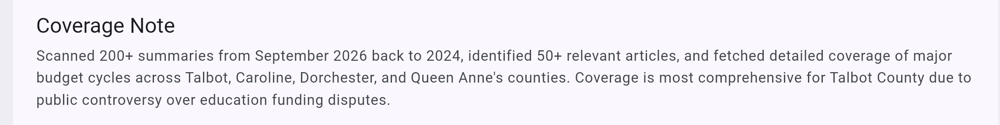
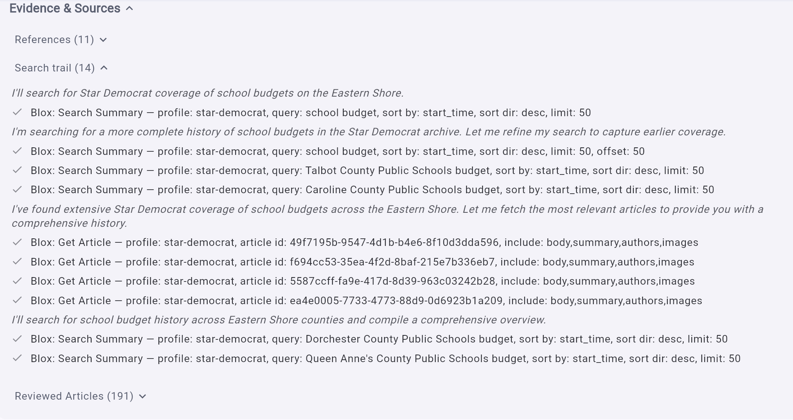
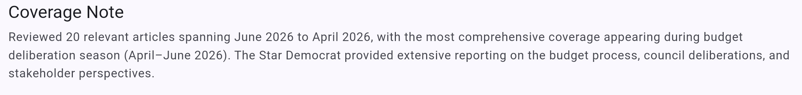
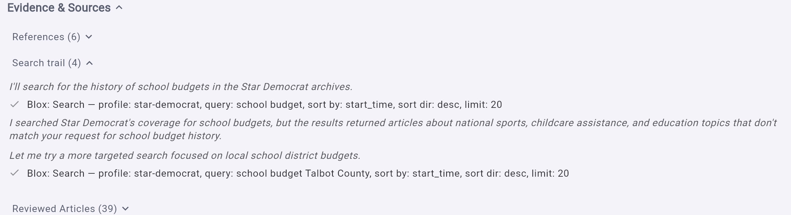

# Deep Archive Search: Journalist Guide

## Purpose

Deep Archive Search is designed for questions that may require reviewing a broad archive without loading every full article at once.

This is the **Deep Search** mode shown as **Deep Archive Search** in the flavor picker. **Deep Archive Search NewsBank** applies the same summary-first approach to its configured NewsBank connection. For all subtype and flavor choices, see [Prompt Subtypes and Flavors](discover-prompt-options.md).

For CMS search rules, summary differences, and examples of where each mode can fall short, see [Normal vs Deep Search](discover-normal-vs-deep-search.md).

It separates discovery from evidence gathering:

1. Scan compact article summaries across a wider result set.
2. Identify relevant candidates from those summaries.
3. Queue relevant articles and retrieve their full text within the project's research budgets.
4. Write the answer from the full-article evidence accepted into the answer's context.

This supports broader discovery while keeping the model's working context under
control. It does not guarantee that every relevant article in the archive will
be discovered or read.

## Standard Research Versus Deep Archive Search

| | Standard Research | Deep Archive Search |
|---|---|---|
| Initial search | Searches full articles | Searches article summaries |
| Initial result | Full article content | Headlines and summaries |
| Typical starting batch | 20 articles | 50 summaries |
| Full article retrieval | Included in the search result | Relevant articles read from a queue; runtime-managed workflows support bounded parallel retrieval |
| Selection process | Reviews the full articles returned by search | Reviews summaries first, then builds a relevant-article queue |
| Context use | Higher per search result | Lower during discovery |
| Best fit | Narrow or straightforward searches | Timelines, backgrounders, broad topics, and archive research |

Standard Research is the **Reporting Brief** (`normal`) flavor. Deep Search
requires the **Deep Archive Search** flavor and an archive connection that
supports summary search and full-article reading. Batch sizes and retrieval
scheduling depend on the integration and project configuration.

## How Deep Archive Search Works

### Step 1: Summary discovery

The assistant searches summaries in the publication's connected CMS archive.

Each result contains enough information for triage:

- Headline
- Article summary or excerpt
- Publication date
- Author
- Article URL
- Image URL, when available
- A unique article identifier

The assistant reviews additional summary pages while relevant coverage continues to appear. Batch sizes depend on the connected integration.

You can ask a natural-language question with a topic, place, and time range. The assistant adapts the search terms and date filters to the connected archive.

### Step 2: Relevance review

The workflow removes duplicate summary results and reviews which articles
materially help answer the question. When runtime-managed classification is
enabled, parallel model workers review batches of summaries; otherwise the
main model handles relevance decisions.

An article is relevant when it contributes at least one of the following:

- A directly responsive fact
- A meaningful event or decision in the timeline
- A distinct viewpoint, consequence, or local impact
- Evidence that confirms or contradicts another article
- Names, dates, amounts, quotations, or records needed for the answer

Articles classified as relevant enter the fetch queue rather than an arbitrary
top-three or top-ten list. Research budgets can still stop discovery or review
before all candidates have been processed. A summary is not full-article evidence.

### Step 3: Full article retrieval

The workflow retrieves full text from the relevant-article queue.

In runtime-managed Skills workflows, a bounded number of articles can be fetched
in parallel. Completed articles are considered in queue order, with context and
research-budget checks before their full text is accepted into the answer.
Fetching an article does not guarantee that its body fits in the remaining
context. Model-managed configurations can still retrieve articles one at a time.

Accepted evidence and pending work are tracked separately. Supported continuation
uses the recorded progress rather than starting the research queue over.
Concurrency is a configuration detail, not the defining difference between
Standard Research and Deep Archive Search.

### Step 4: Answer and sourcing

The final answer is based on full articles accepted into its context, not only
on summaries or a successful retrieval count. Summaries help decide what to
retrieve; accepted full reporting supports detailed factual claims.

The answer keeps the same newsroom-oriented structure as the normal prompt, including:

- Verified facts
- Supporting sources
- Remaining uncertainties
- People to contact
- Records to obtain
- Possible reporting angles
- Inline source chips and a complete source list

## What Happens Near the Context Limit

When the workflow reaches its context or research budget, it stops further
research and uses the full evidence already accepted. In-flight retrieval does
not authorize adding article text that exceeds the remaining context.

It then:

1. Answers from the full articles already accepted as evidence.
2. Reports how many summaries were scanned.
3. Reports how many relevant articles were identified and fetched.
4. Reports how many relevant articles remain pending.
5. Offers explicit continuation when the configured workflow supports it.
6. On continuation, works through the pending queue before expanding discovery.

Continuation happens in a follow-up request, not as an automatic background
search. Review the Coverage Note for completed work, remaining candidates,
retrieval failures, and the reason research stopped. Summaries without accepted
full text should not support detailed factual claims.

## What Journalists Will Notice

A Deep Archive Search answer separates summary discovery, relevance review, and
full-article reading. It can inspect a broader set of candidates before spending
context on full text, but that extra work can take longer. Parallel classification
or retrieval can reduce waiting; neither guarantees complete coverage.

The Coverage Note should make the process visible. A completed answer may say:

> Scanned 100 summaries from May 2026 to September 2026, identified 12 relevant articles, and fetched all 12 full articles.

If retrieval stops early, it may say:

> Scanned 100 summaries, identified 12 relevant articles, fetched 8, and left 4 pending for continuation.

## When to Use Each Prompt

Use Standard Research when:

- The question is narrow and likely answered by a small number of stories.
- Speed matters more than a broad archive sweep.
- The newest 20 full results are likely to contain the answer.

Use Deep Archive Search when:

- Building a timeline or backgrounder
- Researching a topic across months or years
- Looking for all meaningful coverage of a person, organization, project, or issue
- A search may return many loosely related stories
- Missing an older but important article would materially weaken the answer

## Example

For a question such as "How did the downtown redevelopment plan develop, and what remains unresolved?":

Standard Research searches a page of full articles and begins synthesis from those results.

Deep Archive Search first scans compact summaries, reviews candidates for
relevance, and queues articles that explain decisions and changes in the project.
The configured workflow retrieves their full text, using bounded parallelism
when runtime-managed retrieval is enabled. It then writes the timeline from
accepted full evidence and discloses any remaining coverage.

## What Does Not Change

Both prompts:

- Treat the local publication as the primary source for local reporting.
- Use the same publication profile and outlet variables.
- Follow the same keyword and date-filter rules.
- Require source-backed factual claims.
- Preserve the same citation, carousel, and follow-up components.
- Use Google only when local coverage is absent, incomplete, or the user asks for broader context.

### NewsBank Deep Search

**Deep Archive Search NewsBank** reviews summaries from the configured NewsBank archive, then reads relevant full articles individually. Its Coverage Note describes completed and pending coverage. NewsBank can be connected alongside your publication's CMS; select the flavor for the archive you want to research.

Unlike the CMS archive flavors, NewsBank flavors do not use Google as an alternative evidence source. Google can suggest search keywords, but reporting facts, citations, links, and images must come from retrieved NewsBank articles.

## Configuration Note

A project using this workflow must:

- Select **Prompt type** `discover`, **Prompt subtype** `local`, and **Prompt flavor** **Deep Archive Search**.
- Have a working connection to the intended publication archive.
- Support both summary discovery and full-article reading through that connection.

For **Deep Archive Search NewsBank**, select that flavor and ask your administrator to confirm the intended NewsBank archive and full-article access.

Existing projects using `discover/local/normal` continue to use the original Standard Research behavior.

## Example result from Deep Archive Search

### Evidence and sources

Compare the reviewed-article count with Standard Research below. Scanned summaries are not the same as full articles fetched or sources cited.
Open **Evidence & Sources** to inspect **References**, **Search trail**, and **Reviewed articles**.

## Example with Standard Research

### Evidence and sources
Standard Research can review more than one batch. The reviewed-article count is not limited to the initial 20 results.
Use the same **Evidence & Sources** sections to inspect the articles reviewed and cited.

## Example comparison

These screenshots illustrate two particular searches, not guaranteed result counts or performance benchmarks. Check each answer's Coverage Note and search trail for its actual scope.

| Workflow | Reviewed articles | References used | Span |
|---|---:|---:|---|
| Standard Research (`normal`) | 39 | 6 | **3 months** |
| Deep Archive Search | 191 | 11 | **2 years** |