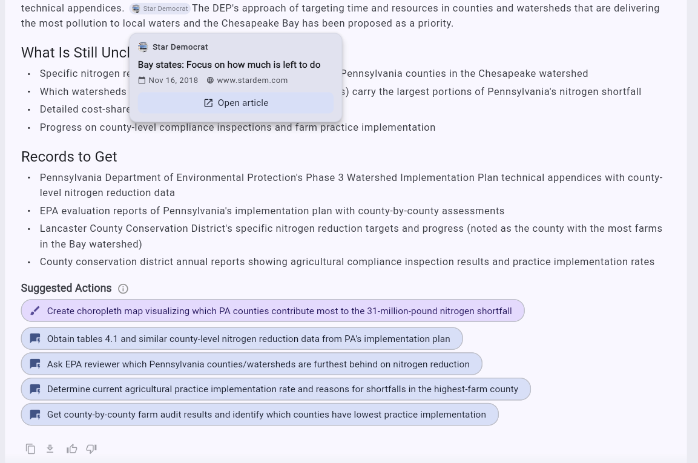

# Research Trails & Response Tools

Every Discover response is built to be checked. This page covers how sourcing is shown, and the tools available on each response.

## Clear research trails

Each query response, along with individual in-line links to specific stories, includes full sourcing that reflects the articles reviewed as well as those directly referenced. This gives reporters a clear research trail for validation.

*Screenshot placeholder — Evidence & Sources panel.*

- **References** — displays all of the articles used to create the response. These articles were read, reviewed, and determined to be relevant to the query.
- **Search trail** — shows all of the actions performed by the assistant and the justification for them.
- **Reviewed articles** — displays all of the articles that were read and reviewed before a response was returned.

### Model reflections

Skills search trails include expandable **Model reflection** entries when the
provider exposes a thinking or reasoning summary. Summaries update while the
response streams and remain available in the saved trail. An interrupted request
is labeled as a partial summary rather than a completed reflection.
Throttled updates are flushed when a summary block ends or the provider moves
to answer text or tool output, so the last received summary chunk does not wait
for the entire response to finish. Text not yet supplied by the provider cannot
be displayed early.

While waiting, only the latest reflection opens automatically. Its text uses
the available trail width and expands naturally, without a height cap or
separate scrollbar. The page follows new reflection text until you scroll,
select text, or interact with the trail. **Jump to latest** resumes following.
Automatically opened reflections collapse when the answer starts;
reflections you opened yourself stay open. The answer start is brought into
view only if you have not scrolled, selected text, or interacted with the trail.
Answer streaming follows only when you are near the bottom or choose **Jump
to latest**. Scrolling away or selecting text pauses following.

This works with Anthropic thinking summaries, OpenAI Responses reasoning
summaries, and Gemini thought summaries where supported by the selected model.
Models or API modes without exposed summaries do not produce reflection entries.
Existing answers cannot recover summaries that were not recorded.

Reflections do not change tool selection, model effort, research steps, or answer
generation. In particular, Haiku 5.5 returns no thinking block during a forced
tool call; those calls remain forced. Its eligible synthesis calls can expose
summaries. Signatures and redacted thinking are never displayed as reflections.
Recorded timestamps distinguish the model request start, first summary received,
first reflection sent, and completion; they do not measure when internal
reasoning began.

## Next steps and feedback

*Screenshot placeholder — response with citations, suggested actions, and feedback tools.*

1. Each fact presented is supported by in-line information about its source material, including the original story headline, publication name, date, and a direct link.
2. If photos are associated with the original stories, they're displayed in the response. Each image can be downloaded for re-use or reference.
3. Suggested actions can also include a call to **LiquidAmber Describe**, which creates a shareable graphic and links out to the embedded Q&A widget on the publisher's site. See [Describe](describe.md).
4. Discover prompts you with **suggested actions** relevant to the current discussion, so you can keep going without composing a new query from scratch.
5. Each response includes tools to help you use it: copy the response, download it as Markdown (.md), and give **thumbs up** or **thumbs down** feedback on the quality of the response.

See also: [Getting Started with Discover](discover-getting-started.md) and [User Interface Guide](discover-interface.md).
