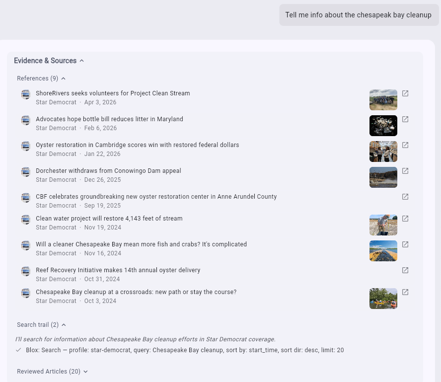

# Research Trails & Response Tools

Every Discover response is built to be checked. This page covers how sourcing is shown, and the tools available on each response.

## Clear research trails

Each query response, along with individual in-line links to specific stories, includes full sourcing that reflects the articles reviewed as well as those directly referenced. This gives reporters a clear research trail for validation.

*Screenshot placeholder — Evidence & Sources panel.*

- **References** — displays all of the articles used to create the response. These articles were read, reviewed, and determined to be relevant to the query.
- **Search trail** — shows all of the actions performed by the assistant and the justification for them.
- **Reviewed articles** — displays all of the articles that were read and reviewed before a response was returned.

### Research progress

Skills responses show a **Research progress** summary above the collapsible
Evidence & Sources panel. It remains visible when that panel is collapsed.
During research, it shows the recorded activity phase and available counts for
candidates, relevant articles, articles read, articles being read, and queued
reads. Expand **Current queue state** for the other recorded counts.

The summary changes to **Writing answer** when answer text starts streaming,
or **Finalizing answer** while a draft is being finalized. After generation,
it shows **Answer generated**, flags recorded research limitations, or identifies
an interrupted request. An answer being generated does not mean every candidate
was classified or every queued article was read. The final state remains
available in saved trails; older responses can show only information that was
recorded.

Queue counts inside individual actions are labeled **Queue state at this step**.
They retain that action's recorded snapshot rather than showing the latest
counts. The progress summary is the single place to inspect the latest queue
state. Article-read counts are distinct from the number of sources cited.

### Review and change article relevance

For saved **Deep Search** answers (**Deep Archive Search** or
**Deep Archive Search NewsBank** in the flavor picker), expand **Final research state**,
then select the button containing the **Relevant** and **Not relevant** counts.
The **Review article relevance** dialog lists the classified articles in both
groups. Unclassified candidates are not included.

Each article shows:

- **Title and link** — select the title to open the original article.
- **Publication date** — or an indication that the date is unavailable.
- **Read status** — Not read, Queued, Reading, Read, Failed, or Blocked.
  Being marked relevant does not mean the full article has been read.
- **Decision origin and date** — AI-classified or manually reviewed, when
  recorded.
- **Retrieval failure** — the recorded error code for a failed or blocked read,
  when available.

Expand **Summary and classification rationale** below an article to read its
summary and original classification reasoning. Missing information is identified;
older records cannot recover details that were not saved.

To change the selection:

1. Select **Move to not relevant** or **Move to relevant** on an article.
2. Review the updated groups. Moves are marked as unsaved until you save them.
3. Select **Save changes**, or **Cancel** to discard your unsaved moves.

Saved changes apply to future continuations of the same research workflow.
They do **not** rewrite the existing answer, change its citations, or immediately
fetch articles. Newly relevant articles that have not been read are queued for
future research. Previously retrieved full articles can be reused if made
relevant again. Manual changes preserve the original classification rationale
and record a separate manual-review date.

The dialog reloads the workflow when opened, and the final-state counts reflect
its current state. Historical action snapshots in the search trail remain
unchanged. Editing is disabled while research is running on the same workflow;
close and reopen the review after it finishes. If another reviewer changes a
decision before you save, reopen the review to load the latest decisions.

### Research cycles

New research trails group search attempts, relevance decisions, and article reads
into expandable **Research cycle** entries. Each new search attempt starts a
cycle; parallel classification and retrieval events carry the cycle identifier
recorded when their operation started. Grouping does not depend on events
arriving next to each other.

While waiting for the answer, the latest cycle opens automatically. Earlier
cycles collapse unless you opened them yourself. Manual expansion and collapse
choices are preserved as progress arrives. When answer writing starts, only
automatically opened cycles collapse. Expand a cycle to inspect its queries,
article links, decisions, and original queue snapshots.

Cycle summaries show the available recorded outcomes: returned results,
articles marked relevant or not relevant, and unique articles read. Returned
results are not a count of new unique candidates; an article may appear in more
than one search. Failures, blocked work, partial results, and missing operation
outcomes remain distinguishable. Cancelled prefetches are reported separately
and do not by themselves mark a cycle as failed.

Model reflections remain outside the cycle groups, so live thinking summaries
remain visible while you wait. Older trails without recorded cycle identifiers
retain their chronological action display rather than guessing cycle boundaries.

### Model reflections

Skills search trails include expandable **Model reflection** entries when the
provider exposes a thinking or reasoning summary. Summaries update while the
response streams and remain available in the saved trail. An interrupted request
is labeled as a partial summary rather than a completed reflection.
Throttled updates are flushed when a summary block ends or the provider moves
to answer text or tool output, so the last received summary chunk does not wait
for the entire response to finish. Text not yet supplied by the provider cannot
be displayed early.

While waiting, only the latest reflection opens automatically. Its text uses
the available trail width and expands naturally, without a height cap or
separate scrollbar. The page follows new reflection text until you scroll,
select text, or interact with the trail. **Jump to latest** resumes following.
Automatically opened reflections collapse when the answer starts;
reflections you opened yourself stay open. The answer start is brought into
view only if you have not scrolled, selected text, or interacted with the trail.
Answer streaming follows only when you are near the bottom or choose **Jump
to latest**. Scrolling away or selecting text pauses following.

This works with Anthropic thinking summaries, OpenAI Responses reasoning
summaries, and Gemini thought summaries where supported by the selected model.
Models or API modes without exposed summaries do not produce reflection entries.
Existing answers cannot recover summaries that were not recorded.

Reflections do not change tool selection, model effort, research steps, or answer
generation. In particular, Haiku 5.5 returns no thinking block during a forced
tool call; those calls remain forced. Its eligible synthesis calls can expose
summaries. Signatures and redacted thinking are never displayed as reflections.
Recorded timestamps distinguish the model request start, first summary received,
first reflection sent, and completion; they do not measure when internal
reasoning began.

## Next steps and feedback

*Screenshot placeholder — response with citations, suggested actions, and feedback tools.*

1. Each fact presented is supported by in-line information about its source material, including the original story headline, publication name, date, and a direct link.
2. If photos are associated with the original stories, they're displayed in the response. Each image can be downloaded for re-use or reference.
3. Suggested actions can also include a call to **LiquidAmber Describe**, which creates a shareable graphic and links out to the embedded Q&A widget on the publisher's site. See [Describe](describe.md).
4. Discover prompts you with **suggested actions** relevant to the current discussion, so you can keep going without composing a new query from scratch.
5. Each response includes tools to help you use it: copy the response, download it as Markdown (.md), and give **thumbs up** or **thumbs down** feedback on the quality of the response.

See also: [Getting Started with Discover](discover-getting-started.md) and [User Interface Guide](discover-interface.md).
